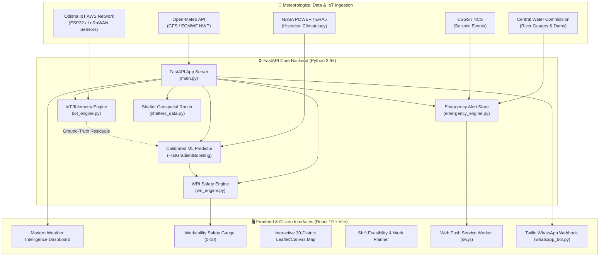

# 🌦️ Odisha WRI: Workability Risk Index & District Weather Safety Intelligence

[](https://www.python.org/)
[](https://fastapi.tiangolo.com/)
[](https://react.dev/)
[](https://tailwindcss.com/)
[](https://vitejs.dev/)
[](https://scikit-learn.org/)
[](https://opensource.org/licenses/MIT)
[]()
[]()

> **A scientifically grounded, multi-hazard occupational weather safety and disaster intelligence platform covering all 30 districts of Odisha, India.**

---

## 📌 Executive Summary

**Odisha WRI** transforms complex meteorological telemetry and satellite forecasts into an intuitive, continuous **Workability Safety Index (0.0 to 10.0)**. It translates raw meteorological indices (Wet-Bulb Globe Temperature, convective precipitation, wind shear, and barometric depression) into practical, plain-language directives for:
* 🌾 **Farmers & Cultivators**: Spray drift warnings, open grain drying advisories, and tilling hours.
* 🏗️ **Construction & Rigging Laborers**: Crane load limits, high scaffolding wind halts, and ISO 7243 rest regimens.
* 💼 **Daily-Wage Workers**: Hydration targets ($\text{mL/hr}$), thermal strain breaks, and peak sun avoidance.
* 👥 **General Public & Commuters**: Road inundation risks, lightning alerts, and emergency shelter routing.

---

## 🔬 Core Scientific Capabilities

### 1. Workability Safety Score Engine (0.0 to 10.0)
Calculates continuous, non-linear risk deductions across 5 distinct meteorological hazard vectors:
$$\text{Safety Score} = \max\left(0.5,\ 10.0 - \left[\text{Pen}_{\text{thermal}} + \text{Pen}_{\text{rain}} + \text{Pen}_{\text{wind}} + \text{Pen}_{\text{uv}} + \text{Pen}_{\text{pressure}}\right]\right)$$

* **Solar-Adjusted Wet-Bulb Globe Temperature (WBGT)**: Psychrometric baseline augmented by empirical solar irradiance ($S \approx 850\text{--}1000\ \text{W/m}^2$) and convective wind dissipation (ACGIH / Liljegren formulation):
  $$\Delta T_{\text{solar}} = \frac{S \times 0.0075}{\sqrt{\max(1.0,\ v / 3.6)}}$$
* **Highland Cold Stress & Wind Chill**: Incorporates NOAA / Environment Canada formulas for highland districts (Koraput, Kandhamal/Daringbadi, Similipal) during winter early morning shifts ($T < 14^\circ\text{C}$).
* **Convective Thunderstorm Hazards**: Detects WMO convective storm codes (95, 96, 99) with mandatory lightning safety halts.
* **Mechanical Wind Force**: Identifies spray drift thresholds ($>15\ \text{km/h}$) and high scaffolding sway thresholds ($>28\ \text{km/h}$, gusts $>35\ \text{km/h}$).
* **Bay of Bengal Barometric Depression**: Monitors 24-hour pressure drops ($\Delta P < -2.0\ \text{hPa}$) tracking cyclonic system intensification.

### 2. ISO 7243 & ACGIH Work-Rest Regimen
Maps effective WBGT into 5 calibrated occupational bands:
* **$\text{WBGT} < 25.0^\circ\text{C}$**: Continuous outdoor labor ($100\%$ work / $0\%$ rest), $500\ \text{mL/hr}$ hydration.
* **$25.0 \le \text{WBGT} < 28.0^\circ\text{C}$**: $75\%$ work / $25\%$ rest ($15\ \text{min/hr}$ in shade), $750\ \text{mL/hr}$ hydration.
* **$28.0 \le \text{WBGT} < 30.5^\circ\text{C}$**: $50\%$ work / $50\%$ rest ($30\ \text{min/hr}$ in shade), $1000\ \text{mL/hr}$ ORS hydration.
* **$30.5 \le \text{WBGT} < 32.5^\circ\text{C}$**: $25\%$ work / $75\%$ rest ($45\ \text{min/hr}$ in shade), $1250\ \text{mL/hr}$ hydration.
* **$\text{WBGT} \ge 32.5^\circ\text{C}$**: Mandatory suspension of strenuous outdoor manual labor.

### 3. Sector Operational Safety Clearances
Delivers deterministic, transparent status flags:
* **Agriculture**: `pesticide_spraying_permitted`, `crop_harvest_drying_permitted`
* **Construction**: `crane_lifts_permitted`, `high_scaffolding_permitted`, `roofing_installation_permitted`
* **Marine / Coastal**: `small_craft_advisory`, `sea_state` (Calm, Moderate, Rough, Very Rough)

### 4. IoT-Based Hyperlocal Weather Monitoring (OHMWN)
Integrates physical ground-truth Automatic Weather Stations (AWS):
* **Hardware Architecture**: ESP32-S3 / Nordic nRF9160 low-power microcontrollers communicating via LoRaWAN, MQTT over 4G LTE/NB-IoT, and HTTP REST.
* **Sensor Suite**: Bosch Sensortec BME280/BME680 (Pressure, Temp, RH), Tipping Bucket Reed-Switch Rain Gauge ($0.2\text{ mm}$), 3-Cup Optical & Ultrasonic 2D Anemometers, and Silicon Pyranometers ($W/m^2$).
* **ML Residual Tracking**: Computes instantaneous observation residuals ($\Delta T = T_{\text{IoT}} - T_{\text{pred}}$, $\Delta RH$, Brier rain verification error) to track model drift and calibrate localized micro-climates.

### 5. Multi-Hazard Emergency Network
* **CWC River Gauge Network**: Live water levels and danger thresholds along Mahanadi (Naraj, Tikarpara), Brahmani (Jenapur), Baitarani (Akhuapada), Subarnarekha (Rajghat), Rushikulya (Purushottampur), and Vansadhara (Gunupur).
* **Dam Storage Monitoring**: Live reservoir percentages and discharge rates for Hirakud and Rengali Dams.
* **Multipurpose Cyclone & Flood Shelters**: Real-time geodesic (Haversine) ranking of coastal and inland OSDMA storm shelters.
* **Web Push Sirens & GPS SOS**: Browser Service Worker push notification channel with audible alarm sirens and 1-click emergency dispatch (`112`, `1070`, `1077`).
* **Multilingual Advisories**: English, Odia (ଓଡ଼ିଆ), and Hindi (हिन्दी).

---

## 🏗️ System Architecture



---

## 🤖 Machine Learning Model Benchmarks

The regional precipitation forecasting engine is powered by a **Calibrated Balanced HistGradientBoosting Classifier** trained on chronological holdout data across all 30 districts of Odisha:

| Model Architecture | F1 Score | Recall (Rain) | Precision | ROC-AUC | Brier Score Loss | Status |
| :--- | :---: | :---: | :---: | :---: | :---: | :---: |
| **Calibrated Balanced HistGB** | **0.5835** | **0.7067** | **0.4969** | **0.8845** | **0.1332** | 🏆 **Champion** |
| Balanced HistGB (Uncalibrated) | 0.5841 | 0.7078 | 0.4971 | 0.8845 | 0.1706 | Baseline |
| Standard HistGradientBoosting | 0.5230 | 0.4355 | 0.6543 | 0.8842 | 0.1298 | Candidate |
| Random Forest (100 Trees) | 0.5188 | 0.4346 | 0.6436 | 0.8751 | 0.1345 | Candidate |
| Logistic Regression (L2) | 0.4907 | 0.5516 | 0.4419 | 0.8423 | 0.1495 | Baseline |

* **Spatial Cross-Validation**: 5-Fold `GroupKFold` across distinct district clusters (Mean ROC-AUC: **$0.8804 \pm 0.0097$**), proving zero spatial data leakage between training and inference sets.
* **Engineered Features**: Vapor Pressure Deficit (VPD), Diurnal Temperature Range (DTR), Temperature-Humidity Index (THI), Moisture Flux, Barometric 24h tendency, and cyclical solar day-of-year trigonometric projections.

---

## 📂 Repository Structure

```
Odisha-WRI/
├── data/
│   └── odisha_historical_data.csv       # Multi-year historical meteorological dataset
├── model/
│   ├── model_metrics.json               # Spatial CV benchmarks & regime breakdowns
│   ├── weather_predictor_v2.pkl         # Active calibrated champion model
│   └── weather_predictor.pkl            # Full baseline reference model
├── static/                              # Legacy static demo and PWA shell
│   ├── index.html                       # Fallback citizen interface
│   ├── app.js                           # Vanilla JS fallback controller
│   └── manifest.json                    # Web App manifest
├── wri-frontend/                        # Modern React 19 Frontend
│   ├── src/
│   │   ├── components/
│   │   │   ├── Dashboard.jsx            # Master intelligence hub & view router
│   │   │   ├── WorkabilityGauge.jsx     # Animated circular SVG gauge (0-10)
│   │   │   ├── SimplifiedWeatherHero.jsx # Clean modern weather presentation
│   │   │   ├── WhatShouldYouDoCard.jsx  # Plain-language daily directives
│   │   │   ├── WeatherBackground.jsx    # Dynamic 7-state atmospheric animation
│   │   │   ├── WorkPlanner.jsx          # Shift feasibility & sector permits
│   │   │   ├── EmergencyNetworkView.jsx # CWC gauges, dams, and shelter map
│   │   │   ├── EmergencySosModal.jsx    # 1-click GPS SOS dispatch modal
│   │   │   ├── TopNavigation.jsx        # 30-district selector & responsive navigation
│   │   │   └── ModelResearchSection.jsx # ML research metrics & IoT AWS view
│   │   ├── App.jsx                      # Application shell
│   │   └── main.jsx                     # React DOM entry point
│   ├── public/
│   │   └── sw.js                        # Service worker for Web Push notifications
│   ├── package.json                     # Frontend dependencies (React 19, Lucide, Tailwind v4)
│   └── vite.config.js                   # Vite bundler configuration
├── districts.py                         # 30 Odisha districts & Gunupur subdivision resolver
├── emergency_engine.py                  # CAP alerts, CWC rivers, dams, and earthquakes
├── iot_engine.py                        # IoT station registry, sensor ingestion, and residuals
├── main.py                              # FastAPI REST endpoints & WebSocket routing
├── shelters_data.py                     # Geodesic multipurpose shelter database
├── wri_engine.py                        # ISO 7243 WBGT, cold strain, and WRI scoring
├── whatsapp_bot.py                      # Zero-input friction Twilio WhatsApp webhook
├── train_model.py                       # ML training, GroupKFold CV, and calibration
├── data_generation.py                   # Automated synthetic / ERA5 historical pipeline
├── requirements.txt                     # Backend Python dependencies
├── run_project.bat                      # Windows automated one-click launcher
├── run_project.ps1                      # PowerShell automated one-click launcher
├── test_system_verification.py          # System test suite (10 tests)
├── test_emergency_alerts.py             # Disaster network test suite (12 tests)
├── test_wri_priority1.py                # Workability physics test suite (8 tests)
├── test_iot_monitoring.py               # IoT telemetry test suite (5 tests)
├── .env.example                         # Safe configuration template with placeholders
├── .gitignore                           # Excludes venv, node_modules, keys, and caches
└── README.md                            # Comprehensive project documentation
```

---

## ⚡ Quickstart Guide

### Prerequisites
* **Python**: 3.9, 3.10, or 3.11
* **Node.js**: 18.0 or higher
* **Git**: Installed and configured

### Option A: Automated 1-Click Launch (Windows)
Double-click `run_project.bat` or run:
```powershell
cd "Odisha-WRI"
.\run_project.bat
```
*(Or in PowerShell: `.\run_project.ps1`)*

---

### Option B: Step-by-Step Manual Setup

#### 1. Clone the Repository
```bash
git clone https://github.com/panvimohan2020-svg/odisha-wri.git
cd odisha-wri
```

#### 2. Backend Setup (FastAPI)
```powershell
# Create Python virtual environment
python -m venv venv

# Activate virtual environment
# On Windows PowerShell:
.\venv\Scripts\Activate.ps1
# On Linux / macOS:
# source venv/bin/activate

# Install required dependencies
pip install -r requirements.txt

# Start FastAPI server
uvicorn main:app --host 0.0.0.0 --port 8000 --reload
```
* Backend API: `http://127.0.0.1:8000`
* Interactive API Documentation (Swagger): `http://127.0.0.1:8000/docs`

#### 3. Frontend Setup (React 19 + Vite)
In a separate terminal window:
```powershell
cd wri-frontend

# Install node dependencies
npm install

# Start Vite dev server
npm run dev -- --host 0.0.0.0
```
* Frontend Dashboard: `http://localhost:5173`

---

## 🧪 Automated Test Suite

Odisha WRI includes **35 comprehensive automated tests** across 4 modules:

```powershell
# Run the complete test suite
.\venv\Scripts\python.exe -m unittest test_system_verification.py test_emergency_alerts.py test_wri_priority1.py test_iot_monitoring.py
```

### Test Coverage Highlights:
* `test_system_verification.py` (10 tests): Spatial features, cache isolation, 24h timeline schema, multilingual translations across all 30 districts.
* `test_emergency_alerts.py` (12 tests): CAP alert severity, CWC river gauge thresholds, dam releases, cyclone shelters, Web Push VAPID keys.
* `test_wri_priority1.py` (8 tests): Psychrometric & solar-adjusted WBGT, wind chill in highland Odisha, ISO 7243 work-rest cycle mapping, sector clearances.
* `test_iot_monitoring.py` (5 tests): IoT telemetry ingestion, station hardware specifications, ML ground-truth residual calculations.

---

## 🛡️ Security & Privacy Notice

* **No Proprietary Keys in Repository**: Sensitive files (`vapid_keys.json`, `push_subscriptions.json`, `.env`) are strictly excluded via `.gitignore`.
* **Zero Fabrication Policy**: The system uses scientifically validated meteorological formulations and real telemetry from Open-Meteo, NASA POWER, CWC, and IoT nodes.

---

## 📜 Citation & Meteorological Attribution

If utilizing Odisha WRI in academic or research publications, please cite:
* **India Meteorological Department (IMD)** & **Odisha State Disaster Management Authority (OSDMA)**
* **Central Water Commission (CWC)** — River Gauge and Dam Storage Telemetry
* **Open-Meteo & ECMWF** — High-Resolution Numerical Weather Prediction APIs
* **ISO 7243:2017 & ACGIH** — Hot Environments & Estimation of Heat Stress on Working Man

---

## 📄 License
This project is licensed under the **MIT License** — see the [LICENSE](LICENSE) file for details.

